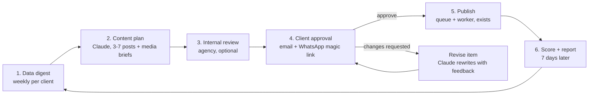

# Podo Social — Autopilot flow plan (1 Nov 2026)

Goal: one automated loop per client that behaves like a social media manager.

> Read the data → plan next week's content → send it to the client for approval → collect the
> decision → publish what was approved → learn from the results → plan the next week better.

Every step is approval-first by default. A per-client **autopilot setting** decides which steps run
without a human (never ads changes, never publishing something the client did not approve).

This document is a build plan. It records what already exists in the code, what is missing, the data
model and jobs to add, and the order to build them. Nothing in it is implemented yet.

---

## 1. The flow



Stage by stage, who or what acts:

| Stage | Trigger | Actor | Output | Human gate |
|---|---|---|---|---|
| 1 Digest | Sunday night cron, per client | worker | `social_client_digests` row: channel performance, best times, format mix, ads, competitors, inbox themes, leads, upcoming occasions, last plan's scorecard | none (read-only) |
| 2 Plan | after digest, Monday 04:00 UTC (exists) | Claude via worker | `social_content_plans` + items, each item = a `SocialPost` draft group with a media brief and a "why" line | none (drafts only) |
| 3 Internal review | plan created | agency user on dashboard | approve all / edit / regenerate item / send to client | **yes**, unless autopilot says "skip internal" |
| 4 Client approval | plan reaches CLIENT | email + WhatsApp to the client's approver(s), reminders at 24h/48h, escalation at 72h | APPROVED / REJECTED per item with reason | **yes, always** |
| 4b Revision | item rejected with a reason | Claude rewrites that item, max 2 rounds | new draft back at CLIENT | client again |
| 5 Publish | APPROVED → QUEUE (exists) | publish worker (exists) | published posts, failures notified | none |
| 6 Score | 7 days after week end | worker | metrics per item, approval rate, edit distance; feeds the next digest; weekly client email | report email gated by setting |
| 6b Ads suggestions | after score | Claude proposes "boost top post", fatigue/overspend fixes as `SocialAiAction` | agency approves in AI approvals | **always** |

---

## 2. What exists today (verified in code, 1 Nov 2026)

| Piece | Where | State |
|---|---|---|
| Data sync: posts (2h), post metrics (6h), stories (4h), daily insights (24h) | `server/analytics/analytics.worker.ts` → `SocialExternalPost`, `SocialInsightDaily` | done |
| Ads sync: structure (2h), insights (1h) | `server/ads/ads.worker.ts` → `AdEntity`, `AdInsightDaily` | done |
| Best posting times per channel | `analyticsService.bestTimes()` (90-day lookback on external posts) | done, not used by the planner |
| Competitor snapshots, leads, inbox threads | `CompetitorSnapshot`, `SocialLead`, `SocialInboxThread` | done, not used by the planner |
| Festival / occasion calendar | `config/festival-calendar.ts` (UI only) | done, not used by the planner |
| Weekly plan | `server/ai/weekly-plan.service.ts`: Monday 04:00 UTC sweep, brand kit + 28-day insight totals + top 8 posts → 3–7 text posts, one channel each, created as DRAFT at `approvalStep = INTERNAL`, tagged "Weekly plan", anchored Monday 09:00 **UTC** | done, v1 |
| Approval state machine | `approval-transitions.ts`: null → INTERNAL → CLIENT → APPROVED (→ QUEUE) / REJECTED | done |
| Client portal | `/approver/portal`: list of posts at CLIENT step, approve / reject with reason, magic-link login (one-time 72h link, 12h session) | done, post-by-post only |
| Magic link delivery | `POST /api/social/clients/[id]/magic-link` returns the link to the dashboard; the agency copies it and sends it by hand | **manual** |
| Approval notifications | `notificationService.approvalNeeded()` → in-app + email to the agency's OWNER/ADMIN only | agency only, **client is never messaged** |
| Publish after approval | `portalDecide()` → `publishQueue.schedule()`; publish worker sweeps every 5 min | done |
| WhatsApp send | `whatsappService.send()` text or Meta-approved template, per connection | done |
| Email | `mailer.sendEmail()` / `sendNotificationEmail()` via Resend | done, `RESEND_API_KEY` not set on prod |
| AI copilot with approval queue | `ai/agent/*`, `SocialAiAction` pending → approve/reject routes | done |
| AI images, branded templates | `aiService.generateImage()`, `branded-template.service.ts` | done, not used by the planner |
| Monthly PDF client report | `server/reports/*` (monthly cron) | done, no weekly email |
| Alerts | overspend (`budget_80`), SLA breach; ad fatigue is a placeholder | partial |
| Autopilot settings | planned in `PODO_SOCIAL.md` §13.6, no table yet | **missing** |

So the skeleton (plan → review → publish) exists. The gaps are: the planner ignores most of the data,
the client is never contacted automatically, there is no revision loop, no plan-level view, no scorecard
feeding back, and no per-client switch for how autonomous it should be.

---

## 3. Data model changes

All new tables carry `organizationId` + `customerId` and go through `scopeWhere()` like everything else.

```prisma
enum SocialContentPlanStatus {
  DRAFT        // generated, nobody has looked
  INTERNAL     // waiting for agency
  CLIENT       // sent to client, waiting
  PARTIAL      // some items approved, some rejected / revising
  APPROVED     // every item approved (posts are QUEUE)
  REJECTED     // client rejected the whole week
  PUBLISHED    // every item published or failed
  SCORED       // metrics collected
}

model SocialClientDigest {
  id             String   @id @default(uuid())
  organizationId String
  customerId     String
  periodStart    DateTime @db.Date
  periodEnd      DateTime @db.Date
  data           Json     // see 4.1
  createdAt      DateTime @default(now())
  @@unique([customerId, periodStart])
  @@map("social_client_digests")
}

model SocialContentPlan {
  id             String  @id @default(uuid())
  organizationId String
  customerId     String
  digestId       String?
  weekStart      DateTime @db.Date
  status         SocialContentPlanStatus @default(DRAFT)
  strategy       Json     // pillars, rationale, channel mix, posting cadence used
  revision       Int      @default(0)
  sentToClientAt DateTime?
  remindedAt     DateTime?
  decidedAt      DateTime?
  scorecard      Json?    // filled at SCORED
  createdAt      DateTime @default(now())
  updatedAt      DateTime @updatedAt
  items          SocialContentPlanItem[]
  @@unique([customerId, weekStart, revision])
  @@index([organizationId, customerId, status])
  @@map("social_content_plans")
}

model SocialContentPlanItem {
  id             String  @id @default(uuid())
  planId         String
  postGroup      String   // SocialPost.group of the draft created for this item
  pillar         String   @db.VarChar(40)   // awareness | value | engagement | offer | proof | occasion
  format         String   @db.VarChar(16)   // text | image | carousel | reel | story
  scheduledAt    DateTime
  hook           String   @db.Text
  mediaBrief     String?  @db.Text
  dataReason     String   @db.Text          // "Reels reached 3.1x images in the last 28 days"
  boostSuggested Boolean  @default(false)
  status         String   @db.VarChar(16) @default("pending") // pending | approved | rejected | revised | published | failed
  feedback       String?  @db.Text          // client's reason, if any
  metrics        Json?                      // filled by plan.score
  createdAt      DateTime @default(now())
  plan SocialContentPlan @relation(fields: [planId], references: [id], onDelete: Cascade)
  @@index([planId, status])
  @@map("social_content_plan_items")
}

model SocialAutopilotSettings {
  id                    String  @id @default(uuid())
  organizationId        String
  customerId            String  @unique
  mode                  String  @default("assisted") @db.VarChar(16) // manual | assisted | autopilot
  skipInternalReview    Boolean @default(false)   // autopilot: plan goes straight to the client
  autoSubmitToClient    Boolean @default(true)    // assisted: agency approves, then it is sent automatically
  autoReviseOnReject    Boolean @default(true)
  maxRevisions          Int     @default(2)
  autoImages            Boolean @default(true)    // generate images for "image" items when a provider exists
  textOnlyFallback      Boolean @default(false)   // send an item without media rather than hold it
  postsPerWeekMin       Int     @default(3)
  postsPerWeekMax       Int     @default(5)
  reminderHours         Json    @default("[24, 48]")
  escalateAfterHours    Int     @default(72)
  weeklyClientEmail     Boolean @default(true)
  adsSuggestions        Boolean @default(true)    // suggestions only, never executed
  updatedAt             DateTime @updatedAt
  @@map("social_autopilot_settings")
}
```

Changes to existing tables:

| Table | Change | Why |
|---|---|---|
| `SocialCustomer` | `timeZone String @default("Asia/Kolkata")` | today plans anchor at 09:00 UTC = 14:30 IST; best-time slots need the client's zone |
| `ClientApprover` | `phone String?` (E.164), `notifyEmail Boolean @default(true)`, `notifyWhatsApp Boolean @default(false)` | WhatsApp delivery of approval requests |
| `SocialPost` | nothing | items link by `group`; `SocialExternalPost.socialPostId` already links published posts to metrics |
| `SOCIAL_NOTIFICATION_TYPES` | add `plan_ready`, `client_decided`, `approval_overdue`, `media_needed` | agency inbox for the new events |

---

## 4. Stage details

### 4.1 Digest (new: `server/ai/digest.service.ts`)

Built per client from tables that are already synced; no new platform calls. Stored as JSON so the
planner, the copilot, the portal ("why this plan") and the weekly email all read the same thing.

```jsonc
{
  "period": { "start": "2026-10-05", "end": "2026-11-01", "timeZone": "Asia/Kolkata" },
  "channels": [{
    "id": "...", "name": "@podo_sphere", "provider": "instagram",
    "followers": 1074, "followersDelta28d": 31, "reach28d": 12040, "reachDeltaPct": 18, "postsLast28d": 9,
    "bestSlots": [{ "dow": 2, "hour": 19, "score": 0.91 }],
    "formatMix": [{ "type": "reel", "posts": 4, "avgReach": 2100, "avgEng": 0.064 },
                  { "type": "image", "posts": 5, "avgReach": 680, "avgEng": 0.031 }],
    "topPosts": [{ "caption": "...", "type": "reel", "reach": 3800, "eng": 0.08, "permalink": "..." }]
  }],
  "ads": { "spend28d": 4200, "ctr": 1.9, "cpc": 6.2, "leads": 11, "topCampaigns": [], "fatigued": [] },
  "competitors": [{ "name": "...", "topPosts": [] }],
  "inboxThemes": ["pricing questions", "LinkedIn connection requests"],
  "leads": { "count28d": 11, "bySource": { "facebook": 7, "whatsapp": 4 } },
  "occasions": [{ "date": "2026-11-05", "name": "Dev Deepawali" }],
  "lastPlan": { "approvalRate": 0.8, "rejectedReasons": ["too salesy"], "bestItem": "...", "worstItem": "..." },
  "cadenceHint": { "postsPerWeek": 4, "source": "template" }
}
```

Sources: `SocialInsightDaily` (followers/reach/impressions, this 28d vs previous 28d), `SocialExternalPost`
(top posts, format mix, `bestTimes()` per channel), `AdInsightDaily` + `AdEntity` for the client's linked
ad accounts, `CompetitorSnapshot`, `SocialInboxThread` previews (untrusted text: wrapped in `<input>` and
summarised at `effort: low`), `SocialLead`, `festival-calendar.ts`, `SocialCustomer.templateBootstrap`,
and the previous `SocialContentPlan.scorecard`.

Job: `digest.build` on the weekly-plan queue, Sunday 22:00 UTC, one per client with channels. Also
callable from the dashboard ("Refresh digest").

### 4.2 Planner v2 (rewrite `weekly-plan.service.ts`)

Inputs to Claude (`effort: high`, structured output):
brand kit + digest + autopilot limits (posts/week, formats allowed) + the client's time zone.

Output schema per item: `pillar`, `format`, `channelIds[]` (one caption variant per channel, not one
channel per post), `dayOffset`, `slot` (chosen from `bestSlots`), `hook`, `captions[channelId]`,
`hashtags`, `cta`, `mediaBrief`, `dataReason`, `boostSuggested`, `occasion?`.

What the service does with it:
1. Create a `SocialContentPlan` (DRAFT) and one `SocialPost` draft group per item at the slot time in the
   client's zone (`creationMethod: AI`, tag "Weekly plan", `approvalStep = INTERNAL`, or `CLIENT` when
   `skipInternalReview`).
2. `format = image` and `autoImages` on: call `aiService.generateImage()` with the media brief, attach the
   media id. `carousel | reel | story`: leave media empty, create a `media_needed` notification with the
   brief for the agency. Items without media are held (`textOnlyFallback` off) and never sent to the
   client until media is attached.
3. Plan status → INTERNAL (or CLIENT) and `plan_ready` notification.

Rules kept in code, not the prompt: channel ids come from the scope; the model cannot pick a channel it
was not given; max posts per week from settings; no offers or numbers that are not in the brand kit or
digest (already in the prompt, keep it).

### 4.3 Internal review (dashboard)

New page `/dashboard/social/ai/plans` (list) and `/dashboard/social/ai/plans/[id]` (detail):
week grid, each item with caption per channel, media, the `dataReason`, and actions
**Approve all → send to client**, **Edit** (opens the composer on that group), **Regenerate item**
(Claude, with an optional instruction), **Drop item**, **Reject plan**.

"Approve all" calls `approvalService.agencyAction(..., 'approve')` for every group and then the delivery
service (4.4). The existing calendar keeps working post by post.

### 4.4 Client approval delivery (new: `server/approvals/approval-delivery.service.ts`)

Called whenever a plan or a post group enters `CLIENT` (hook in `approvalService.agencyAction` and in
the plan service). For each approver of the client:

1. Mint a fresh magic link (`approvalService.generateMagicLink`), which also invalidates older ones.
2. Email (Resend): subject "`<count>` posts for the week of `<date>` need your approval", a table
   (day, channel, hook, thumbnail), one **Review and approve** button. Skipped when `RESEND_API_KEY`
   is missing; logged.
3. WhatsApp (when `notifyWhatsApp` and `phone` are set): Meta-approved **utility** template
   `podo_plan_approval` with `{{client}}`, `{{count}}`, `{{week}}` and a URL button carrying the link.
   Sent from the agency's own WhatsApp connection (`customerId = null`) so every client gets it even
   without their own number connected. Requires creating + approving the template in WhatsApp Manager
   (one-time; needs the user's go-ahead per the MCP consent rule).
4. Audit row `approval.sent` with channel used; `plan.sentToClientAt` set.

Reminders: job `plan.remind` runs hourly, finds plans at CLIENT past each `reminderHours` mark, re-mints
the link and re-sends (email first, WhatsApp if enabled). After `escalateAfterHours`: `approval_overdue`
notification to the agency. Links expire at 72h, which is why reminders re-mint.

Portal changes (`/approver/portal`, mobile-first because clients will open it from WhatsApp):
a **This week** tab showing the whole plan, **Approve all**, per-item **Approve** / **Request changes**
(text box), optional inline caption edit (saved as the client's version, flagged `edited_by_client`),
and a "why this post" line from `dataReason`. Decisions go through `portalDecide()` as today, plus a
plan-level endpoint `POST /api/approver/plans/[id]` that loops the groups and sets the plan status
(APPROVED / PARTIAL / REJECTED).

Not in scope for v1: approving by replying to the WhatsApp message. Quick-reply buttons would need the
phone number to be bound to the approver and a confirmation code; it can come after the link flow is
stable (phase 3b).

### 4.5 Revision loop

On `REJECTED` with feedback and `autoReviseOnReject`: job `plan.revise(itemId)` → Claude rewrites the
item (`effort: medium`) with the brand kit, the original, the feedback, and the digest → a new draft
group replaces the old one (old group soft-deleted, item `status = revised`, `plan.revision + 1`) →
back to `CLIENT` → delivery runs again for that item only. Stops after `maxRevisions`, then the agency
gets a notification and takes over by hand.

### 4.6 Publish

Unchanged: APPROVED posts are already in `QUEUE` and picked up by the publish worker. Additions:
`plan.status = PUBLISHED` once every item is PUBLISHED or ERROR; item `status` mirrors the post;
`post_failed` already notifies the agency. Optional "your week is live" email to the client, off by
default.

Pre-flight at the moment a plan is sent to the client: every Instagram / Pinterest item must have
media; caption lengths per platform; publish date in the future. Fails loudly in the dashboard, never
silently drops an item.

### 4.7 Score, learn, report

Job `plan.score`, 7 days after `weekStart + 6`: for each item join `SocialExternalPost` on
`socialPostId` → reach, engagement, saves, clicks; compare with the channel's 28-day average
(`uplift`); approval rate; edit distance between the AI caption and the published text; rejected reasons.
Stored in `item.metrics` and `plan.scorecard`, status → SCORED. The next digest reads it (`lastPlan`),
so week N+1 is planned with week N's results.

Weekly client email (when `weeklyClientEmail`): three lines of results + next week's plan preview, sent
with the approval request so the client gets one message, not two.

Ads loop (suggestions only): after scoring, if an item beat its channel average by 2x and
`adsSuggestions` is on, create a `SocialAiAction` `propose_boost(postId, budget, days)`; overspend and
fatigue rules (`alert.service.ts`, fatigue is a placeholder today) create `propose_ad_change` actions.
The agency approves them in the AI approvals list; nothing touches an ad account without that.

---

## 5. Jobs and queues

Keep one queue (`social-ai-weekly-plan-queue`, rename to `social-autopilot-queue`) and one worker file.

| Job | Schedule | Does |
|---|---|---|
| `digest.build` | Sun 22:00 UTC per client | 4.1 |
| `plan.generate` | Mon 04:00 UTC per client (exists) | 4.2, waits for the digest of the same week |
| `plan.deliver` | on CLIENT | 4.4 |
| `plan.remind` | hourly | reminders + escalation |
| `plan.revise` | on reject | 4.5 |
| `plan.score` | daily, picks plans due | 4.7 |
| `plan.ads-suggest` | after score | 4.7 |

All jobs are idempotent by `jobId` (`<job>_<customerId>_<weekStart>`), as the existing sweep already does.

---

## 6. API routes to add

| Route | Who | Purpose |
|---|---|---|
| `GET /api/social/ai/digest` | agency | latest digest for the selected client |
| `POST /api/social/ai/digest` | agency | rebuild now |
| `GET /api/social/ai/plans`, `GET /api/social/ai/plans/[id]` | agency | list / detail |
| `POST /api/social/ai/plans/[id]/approve-all` | agency | internal approve + send |
| `POST /api/social/ai/plans/[id]/items/[itemId]/regenerate` | agency | Claude rewrite with instruction |
| `POST /api/social/ai/plans/[id]/send` | agency | (re)send approval request |
| `GET/PUT /api/social/clients/[id]/autopilot` | agency OWNER/ADMIN | settings |
| `PUT /api/social/clients/[id]/approvers/[approverId]` | agency | phone + notify flags |
| `GET /api/approver/plans/current`, `POST /api/approver/plans/[id]` | client portal | plan view + decide all |
| public `/api/v1/plans` (read) | API clients | later |

Agent tools to add in `ai/agent/tools.ts`: `get_client_digest` (read), `get_content_plan` (read),
`regenerate_plan_item` (write, approval). Then the copilot can do "make Thursday's post about the
webinar" from chat.

---

## 7. Build order

| Phase | Scope | Est. | Done when |
|---|---|---|---|
| 0 Prereqs | Set `ANTHROPIC_API_KEY` and `RESEND_API_KEY` on prod; run the existing weekly plan once for the PodoSphere client; fix `ownerForPage()` fallback (return null); add `SocialCustomer.timeZone`; run the probe cleanup SQL from `data/go-live/README.md` | 1 day | drafts appear under Internal review for PodoSphere |
| 1 Digest | `digest.service.ts`, table, job, `GET /digest`, a "Data this week" card on the AI page | 2–3 days | digest JSON matches the dashboard analytics numbers for one client |
| 2 Planner v2 | plan tables, prompt + schema, per-channel captions, best-time slots, media briefs, auto images, plans pages | 3–4 days | a week's plan with reasons shows on `/ai/plans`, drafts land in the calendar at IST times |
| 3 Delivery | approver phone/flags, delivery service, email template, WhatsApp template (needs approval), reminders, escalation, portal "This week" tab + approve all + request changes | 3–4 days | sending a plan to the PodoSphere approver (you) arrives by email and WhatsApp and can be approved from the phone |
| 4 Autopilot + revisions | settings table + UI, `plan.revise`, modes manual/assisted/autopilot, agent tools | 2–3 days | a rejected item comes back rewritten without anyone touching the dashboard |
| 5 Publish readiness | pre-flight checks, media-needed notifications, plan status PUBLISHED | 1–2 days | an IG item without media cannot be sent; failures are visible |
| 6 Learn loop | `plan.score`, scorecard, `lastPlan` in digest, weekly client email, boost / fatigue suggestions as AI actions | 2–3 days | week 2's plan cites week 1's results |
| 7 Hardening | transition tests (plan state machine, like `approval-transitions.test.ts`), digest unit tests on seeded data, delivery tests with mocked mailer/WhatsApp, `pnpm smoke` extension, cost check against `aiMonthlyBudgetUsd` | 1–2 days | `pnpm lint && pnpm typecheck` clean, tests green, one full loop run on PodoSphere's own channels |

Total: about 15–20 working days for one developer. Phases 1 and 3 can run in parallel.

Run it on PodoSphere's own client first (assets already verified: Page 259986377195834, IG
17841459370728904, WhatsApp +91 91191 05802). Switch a real client on only after Meta App Review.

---

## 8. Decisions taken in this plan (change them if wrong)

1. Weekly cadence, Monday start, planned Sunday night. Monthly strategy is not a separate object; the
   digest's `lastPlan` chain is the memory.
2. Approval requests go out from the **agency's** WhatsApp number and the agency's Resend sender, with the
   client's branding in the portal (white-label already exists).
3. Autopilot never publishes without the client's APPROVED, never changes ads, never deletes. "Autopilot"
   mode only removes the agency's internal review step and automates sending, reminders and revisions.
4. Client time zone defaults to Asia/Kolkata.
5. Replying "yes" on WhatsApp to approve is deferred (phase 3b) until the link flow is stable.
6. Video and carousels stay human-made; the planner writes the brief and the agency uploads the media.

## 9. Things only you can do before build starts

- Put `ANTHROPIC_API_KEY` and `RESEND_API_KEY` in the production `.env` and restart both pm2 apps.
- Decide the WhatsApp sender: the PodoSphere number (+91 91191 05802) is already verified; the
  `podo_plan_approval` utility template needs to be created and approved by Meta (I can do it through the
  WhatsApp MCP once you say yes).
- Confirm the approver for PodoSocial's own client (your email, your WhatsApp number) so phase 3 can be
  tested end-to-end on yourself.
